

  

  
  &nbsp;·&nbsp;
  
  &nbsp;·&nbsp;
  
  &nbsp;·&nbsp;
  

---

<h2 id="sobre" align="center">
  
</h2>

**Sou Marcos Gabriel, dev full-stack.**

Meu trabalho principal é TypeScript e Python: IDE de banco de dados com IA (DBLion), apps web com exportação real (PixPlaca, MakeYourPoster) e ferramentas de terminal em Rust (my-dev-clock). Backend com testes, frontend que o usuário final usa.

---

<h2 id="stack" align="center">
  
</h2>

**Frontend:** TypeScript · React · Electron · Tailwind · HTML5
**Backend:** Python · Flask · Django · REST APIs
**Banco de dados:** PostgreSQL · MySQL · SQLite · MongoDB · Redis
**Ferramentas:** Rust · Git · GitHub Actions · VS Code

---

<h2 id="projetos" align="center">
  
</h2>

### [DBLion](https://github.com/HyperTechDevelopment/DBLion) · [demo](https://hypertechdevelopment.github.io/DBLion-Page/)

IDE de banco de dados com copiloto de IA. A IA escreve o SQL, você confere e roda. Vem com read-only ligado.

[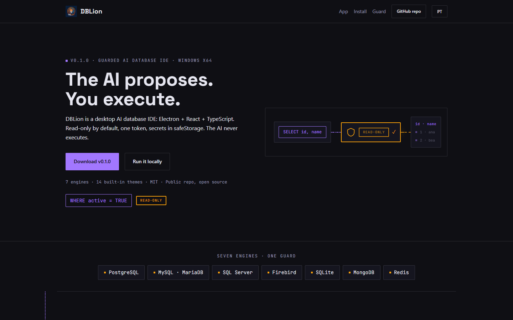](https://hypertechdevelopment.github.io/DBLion-Page/)

### [pixplaca](https://github.com/HyperTechDevelopment/pixplaca) · [demo](https://hypertechdevelopment.github.io/pixplaca/)

Gerador de placas de QR Code Pix com 30 designs e download em PNG ou PDF.

[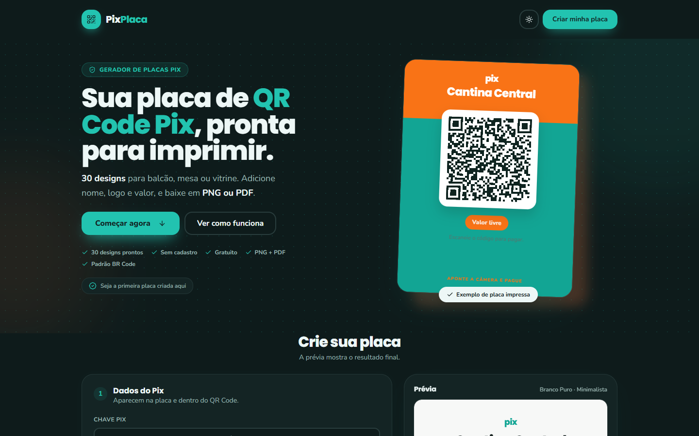](https://hypertechdevelopment.github.io/pixplaca/)

### [my-dev-clock](https://github.com/HyperTechDevelopment/My-dev-clock) · [demo](https://hypertechdevelopment.github.io/my-dev-clock-page/)

Relógio de terminal para Windows em Rust, com timer, cronômetro e contagem regressiva.

[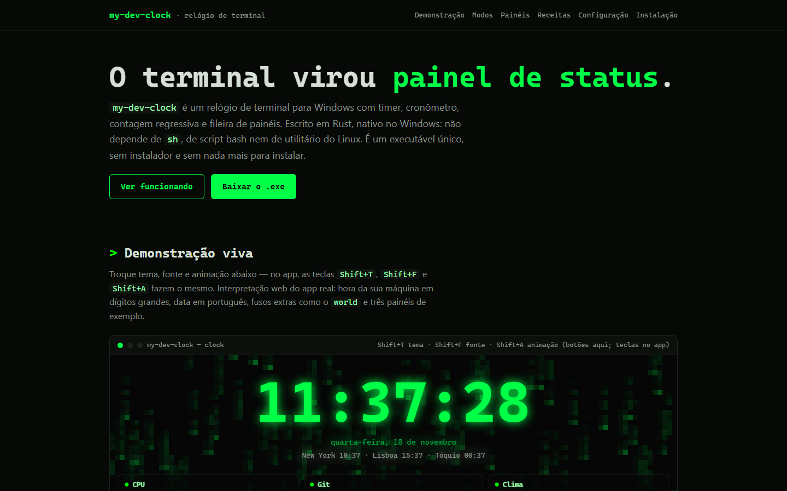](https://hypertechdevelopment.github.io/my-dev-clock-page/)

### [paranoid-agent](https://github.com/HyperTechDevelopment/paranoid-agent)

Skill de segurança com servidor MCP. Varre os últimos 10 commits, procura segredo vazado, roda um ataque contido contra o próprio projeto e fecha com um relatório HTML e nota de 0 a 100. Sem demo pública; o print é do template de relatório.

[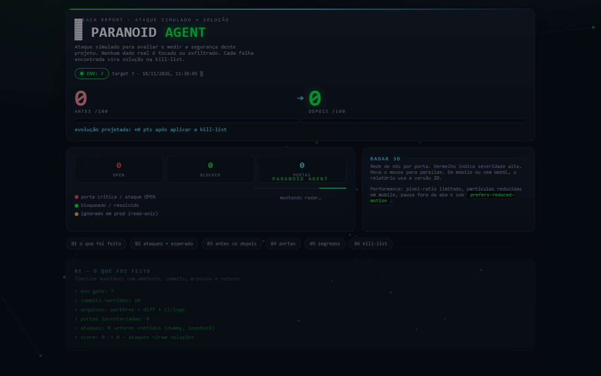](https://github.com/HyperTechDevelopment/paranoid-agent)

### [Sol-Mode](https://github.com/HyperTechDevelopment/Sol-Mode) · [demo](https://hypertechdevelopment.github.io/sol-skill/)

Método de trabalho para agentes de IA, do pedido até o resultado verificado.

[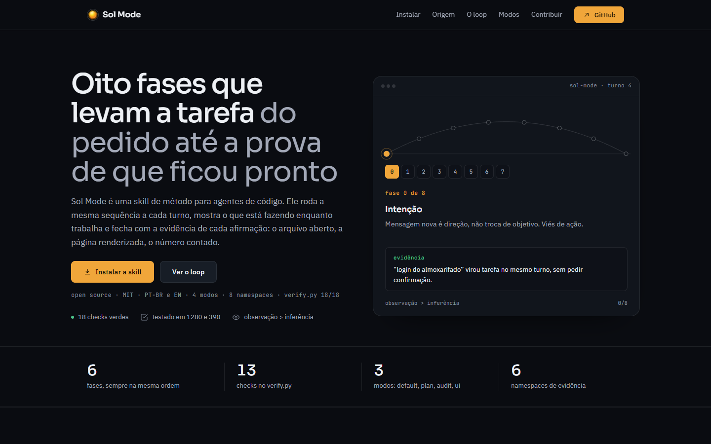](https://hypertechdevelopment.github.io/sol-skill/)

### [Pipeline-for-AI](https://github.com/HyperTechDevelopment/Pipeline-for-AI) · [demo](https://hypertechdevelopment.github.io/Pipeline-for-AI/)

Catálogo de pipelines de skills para feature, debug de agente, interface e entrega. Cada estágio tem entrega e critério de saída definidos.

[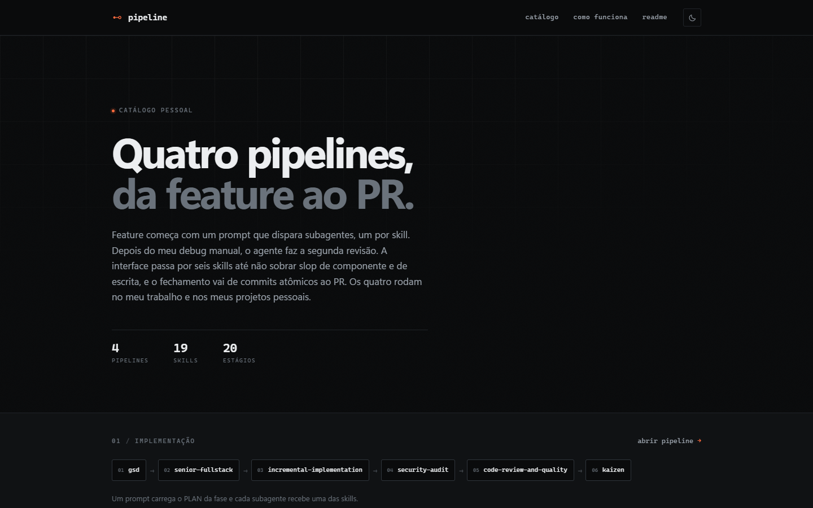](https://hypertechdevelopment.github.io/Pipeline-for-AI/)

### [MakeYourPoster](https://github.com/HyperTechDevelopment/MakeYourPoster) · [demo](https://hypertechdevelopment.github.io/MakeYourPoster/)

Editor de pôster no navegador, com exportação em JPG, PNG e PDF.

[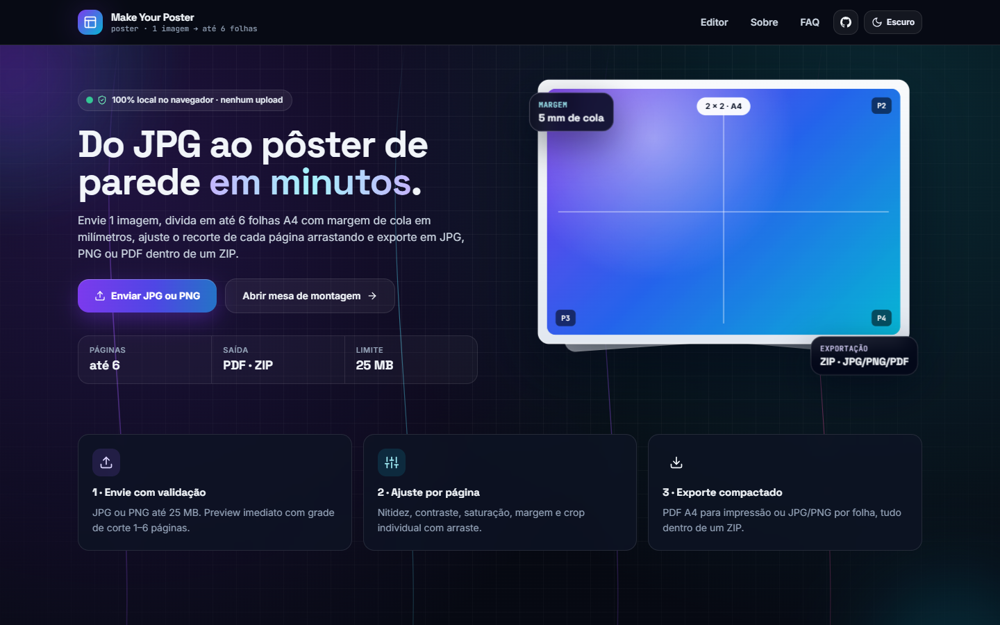](https://hypertechdevelopment.github.io/MakeYourPoster/)

---

<h2 id="contato" align="center">
  
</h2>

  

  
  
  

---

  
  
  

  © 2026 Marcos Gabriel

